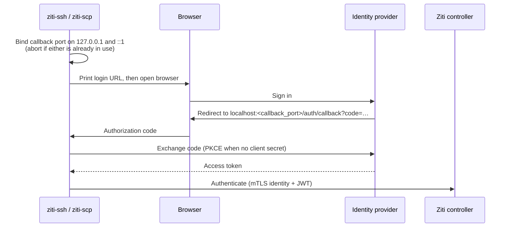

# Configuration reference

All binaries resolve each setting in the same order: CLI flag > environment variable > built-in default. `ziti-ssh` additionally reads `~/.config/ziti-ssh/config.yaml` between the environment variable and the built-in default.

---

## `ziti-ssh`

### Persistent flags (available to all subcommands)

| Flag | Env | Default | Description |
|---|---|---|---|
| `--identity` | `ZITI_IDENTITY` | — | Path to Ziti identity JSON file |
| `--config` | — | `~/.config/ziti-ssh/config.yaml` | Config file path |
| `--ziti-timeout` | `ZITI_TIMEOUT` | `30s` | Timeout for blocking Ziti network operations (authenticate, dial). Accepts any `time.Duration` string, e.g. `30s`, `1m`. |
| `--verbose` / `-v` | — | false | Enable Info-level logging (plumbing details, key paths, service names) |

### `ziti-ssh connect` / root

| Flag | Env | Default | Description |
|---|---|---|---|
| `--ca-service` | `ZITI_CA_SERVICE` | `ssh-ca` | CA service name |
| `--ssh-service` | `ZITI_SSH_SERVICE` | `ssh` | SSH service name |
| `--service` | — | — | SSH service name to dial (alias for `--ssh-service`) |
| `--key` | — | auto-detect | SSH private key path |
| `--oidc-issuer` | — | — | OIDC issuer URL; triggers browser-based OIDC auth (overrides `oidc.issuer` in config) |
| `-N` / `--no-shell` | — | false | Do not open a shell; only run port forwards. Requires at least one `-L`, `-R`, or `-D`. |
| `-A` / `--forward-agent` | — | false | Forward the local SSH agent to the remote session. Refused unless `--forward-agent-unverified` is also given (the host cannot yet be verified), and the CA must grant `permit-agent-forwarding`. Requires `SSH_AUTH_SOCK`. Non-fatal if the agent is unreachable — session continues without forwarding. |
| `--forward-agent-unverified` | — | false | Allow `-A` although the host's identity cannot be verified. The remote host can use your agent while you are connected. |
| `-L` / `--local-forward` | — | — | Local port forward: `[bind:]localport:remotehost:remoteport`. May be repeated. |
| `-R` / `--remote-forward` | — | — | Remote port forward: `[bind:]remoteport:localhost:localport`. May be repeated. |
| `-D` / `--dynamic` | — | — | Dynamic SOCKS5 proxy: `[bind:]port`. May be repeated. |

### `ziti-ssh proxy`

| Flag | Env | Default | Description |
|---|---|---|---|
| `--ca-service` | `ZITI_CA_SERVICE` | `ssh-ca` | CA service name (for cert auto-refresh) |
| `--ssh-service` | `ZITI_SSH_SERVICE` | `ssh` | SSH service name |
| `--service` | — | — | SSH service name to dial (alias for `--ssh-service`) |
| `--key` | — | auto-detect | SSH private key path (used for cert refresh check) |
| `--oidc-issuer` | — | — | OIDC issuer URL; triggers browser-based OIDC auth before dialling |

`proxy` dials the Ziti service and bridges `stdin`/`stdout` to the raw connection. Intended for use as a `ProxyCommand` in `~/.ssh/config`. See [Using ziti-ssh as a ProxyCommand](usage.md#using-ziti-ssh-as-a-proxycommand) in the usage guide.

### `ziti-ssh sign`

| Flag | Env | Default | Description |
|---|---|---|---|
| `--ca-service` | `ZITI_CA_SERVICE` | `ssh-ca` | CA service name |
| `--key` | — | auto-detect | SSH private key path |

### `ziti-ssh enroll`

| Flag | Env | Default | Description |
|---|---|---|---|
| `--jwt` | — | — | Enrollment JWT file path (required) |
| `--out` | — | `~/.config/ziti-ssh/<name>.json` | Output path for identity JSON |

### `ziti-ssh mfa enable`

| Flag | Default | Description |
|---|---|---|
| `--qr-code` / `-q` | false | Print provisioning URL for use with a TOTP app |

---

### `ziti-ssh known-hosts`

| Subcommand | Description |
|---|---|
| `list` | List remembered host keys: Ziti address, key type, SHA256 fingerprint |
| `remove <address>` | Forget the key(s) for an address (`<host>@<service>` or `<service>`), e.g. after a host was rebuilt |

Host keys are stored in `$XDG_CONFIG_HOME/ziti-ssh/known_hosts` (default under `~/.config/ziti-ssh/`). See [usage.md](usage.md#host-keys-trust-on-first-use).

## `ziti-ssh-ca`

| Flag | Environment variable | Default | Required | Description |
|---|---|---|---|---|
| `--identity` | `ZITI_IDENTITY` | — | Yes | Path to Ziti identity JSON file |
| `--ca-key` | `ZITI_CA_KEY` | — | Yes | Path to controller intermediate CA private key |
| `--service` | `ZITI_CA_SERVICE` | `ssh-ca` | No | Ziti service name to bind |
| `--principal` | `ZITI_SSH_PRINCIPAL` | `ziggy` | No | Linux username placed in `ValidPrincipals` (shared mode only) |
| `--mode` | `ZITI_SSH_MODE` | `shared` | No | Principal mode: `shared` or `per-identity` |
| `--cert-ttl` | `ZITI_CERT_TTL` | `5m` | No | Certificate validity duration (e.g. `4h`, `12h`, `24h`); must be > 0 |
| `--cert-extensions` | `ZITI_CERT_EXTENSIONS` | `permit-pty,permit-port-forwarding` | No | Certificate extensions (permissions) to grant, comma-separated, or `none`. Valid: `permit-pty`, `permit-port-forwarding`, `permit-agent-forwarding`, `permit-X11-forwarding`, `permit-user-rc`, `no-touch-required`. Agent forwarding is not granted by default. |
| `--cert-source-address` | `ZITI_CERT_SOURCE_ADDRESS` | `127.0.0.1/32,::1/128` | No | Comma-separated IPs/CIDRs written to each certificate's `source-address` critical option; sshd accepts the certificate only from those addresses. The default (loopback) means certificates work only through `ziti-ssh-host`'s local proxy. `none` disables it. |
| `--rate-limit` | `ZITI_RATE_LIMIT` | `5` | No | Maximum requests (cert signing and CA public key) per minute per identity (decimal values accepted for sub-minute rates) |
| `--rate-burst` | `ZITI_RATE_BURST` | `3` | No | Burst allowance for the per-identity token-bucket rate limiter |
| `--max-connections` | `ZITI_MAX_CONNECTIONS` | `64` | No | Maximum concurrent CA connections; further connections are closed immediately. Each connection has a 10 s deadline. |
| `--ziti-timeout` | `ZITI_TIMEOUT` | `30s` | No | Timeout for blocking Ziti network operations (authenticate, listen). Accepts any `time.Duration` string, e.g. `30s`, `1m`. |

### `ziti-ssh-ca enroll` subcommand

Enrolls the CA server's Ziti identity from a one-time JWT file. Writes the identity JSON to `/etc/ziti-ssh-ca/identity.json` (mode 0600) by default.

| Flag | Default | Description |
|---|---|---|
| `--jwt` | — (required) | Path to the one-time enrollment JWT file |
| `--out` | `/etc/ziti-ssh-ca/identity.json` | Output path for the enrolled identity JSON |

### `ziti-ssh-ca config` subcommands

The `config` subcommand manages the `ziti-ssh-host.v1` config type on the Ziti controller via the management API (HTTPS, username/password). It does not use the Ziti identity file.

| Subcommand | Description |
|---|---|
| `config print` | Print the `ziti-ssh-host.v1` field table and JSON schema to stdout. No controller connection required. |
| `config apply` | Idempotently create or update the `ziti-ssh-host.v1` config type on the controller. Safe to re-run. |
| `config remove` | Remove the `ziti-ssh-host.v1` config type from the controller if it exists. |

`config apply` and `config remove` require the following flags (or their environment variable equivalents):

| Flag | Environment variable | Default | Description |
|---|---|---|---|
| `--controller` | `ZITI_CTRL_ADDRESS` | — | Controller hostname, optionally with port (default port: 443). Do not include `https://`. |
| `--username` | `ZITI_CTRL_USERNAME` | — | Controller admin username |
| `--password` | `ZITI_CTRL_PASSWORD` | — | Controller admin password. The flag is visible in the process list and prints a warning; prefer the environment variable, `--password-file`, or the interactive prompt (used when none is given and a terminal is attached). |
| `--password-file` | `ZITI_CTRL_PASSWORD_FILE` | — | Read the password from the first line of a file; `-` reads stdin |
| `--yes` / `-y` | — | false | Trust the controller's CA bundle on first use without asking. Never replaces a saved bundle that no longer matches. |
| `--insecure` | `ZITI_CTRL_INSECURE` | false | Skip TLS certificate verification (last resort; prints a warning — the admin password is sent unverified). Normally the controller's own CA bundle is fetched, confirmed and saved instead (see provisioning). Mutually exclusive with `--controller-ca`. |
| `--controller-ca` | `ZITI_CTRL_CA` | — | Path to PEM CA certificate to trust for the controller TLS connection. Mutually exclusive with `--insecure`. |

See [Configuring per-identity permissions](provisioning.md#configuring-per-identity-permissions-ziti-ssh-hostv1) in the provisioning guide for usage examples.

---

## `ziti-ssh-host`

These flags are persistent (accepted by both `enroll` and `run`):

| Flag | Environment variable | Default | Description |
|---|---|---|---|
| `--identity` | `ZITI_IDENTITY` | `/etc/ziti-ssh-host/identity.json` | Path to Ziti identity JSON file |
| `--ssh-service` | `ZITI_SSH_SERVICE` | `ssh` | Ziti service name(s) to proxy (used during `run`). The flag may be repeated for multiple services; the env var accepts a comma-separated list. |
| `--ziti-timeout` | `ZITI_TIMEOUT` | `30s` | Timeout for blocking Ziti network operations (authenticate, listen). Accepts any `time.Duration` string, e.g. `30s`, `1m`. |

The `run` subcommand also accepts:

| Flag | Environment variable | Default | Description |
|---|---|---|---|
| `--mode` | `ZITI_SSH_MODE` | `shared` | Principal mode: `shared` or `per-identity` |
| — | `ZITI_SSH_GROUPS` | — | Comma-separated Linux groups set as the user's supplementary groups (via `usermod -G`, replacing existing membership) for users not matched by a `ziti-ssh-host.v1` config entry. Global fallback; per-identity mode only. Groups must already exist on the host; if setting them fails, the connection is rejected. |
| — | `ZITI_SUDOERS_RULE` | — | If set, a sudoers rule `<username> <value>` is written to `/etc/sudoers.d/ziti-ssh-host-<username>` on connect. Global fallback applied to users not matched by a `ziti-ssh-host.v1` config entry; per-identity mode only. |
| — | `ZITI_USER_CLEANUP` | `false` | Set to `true` to delete the Linux account after the last session closes via `userdel -r` (per-identity mode only) |
| — | `ZITI_ALLOW_SUDOERS` | — | Services whose `ziti-ssh-host.v1` config may set `sudoers_rule`: comma-separated service names, or `*` for all. A config `sudoers_rule` from any other service is refused and the connection rejected. Does not affect `ZITI_SUDOERS_RULE`. |
| — | `ZITI_ALLOW_GROUPS` | — | Privileged groups a service's config may grant, as `<service>:<group>` (or `*:<group>` for all services), comma-separated. By default a config may grant any group except `root`, `sudo`, `admin`, `wheel`, `docker`, `lxd`, `disk`, `shadow`, `libvirt`. |
| — | `ZITI_RESTRICT_GROUPS` | `false` | `true`: a config may grant **only** groups listed in `ZITI_ALLOW_GROUPS` (for hosts where custom groups carry sudo rights). Does not affect `ZITI_SSH_GROUPS`. |
| — | `ZITI_TERMINATE_ON_DISCONNECT` | `false` | Set to `true` to end all of the account's processes when the last session closes, keeping the account and home directory (per-identity mode with `ZITI_USER_CLEANUP=false`; no effect when cleanup is on, which already ends them). Without it, background processes (`nohup`, `tmux`, systemd user services) survive disconnect and revocation. |

`enroll` also requires `--jwt <path>` (no environment variable equivalent).

### `ziti-ssh-host inspect`

| Flag | Environment variable | Default | Description |
|---|---|---|---|
| `--service` | — | — | Ziti service name to inspect. Required; may be repeated to inspect multiple services. |

Uses the same `--identity` flag (and `ZITI_IDENTITY` env var) as the other subcommands. See [Inspecting per-identity permissions](operations.md#inspecting-per-identity-permissions) in the operations guide for details and example output.

### `ziti-ssh-host users list` / `users claim`

Administer the per-identity account ownership registry (`/var/lib/ziti-ssh-host/owned-users.json`). Both must run as root; neither connects to the Ziti network.

`users list` takes no flags. `users claim` flags:

| Flag | Environment variable | Default | Description |
|---|---|---|---|
| `--username` | — | — | Existing Linux username to register. Must equal the username derived from `--identity`. Required. |
| `--identity` | — | — | Ziti identity name that owns the account. Required. |

See [Managing account ownership](operations.md#managing-account-ownership) for when and how to use them.

---

## `ziti-scp`

### Persistent flags (available to all subcommands)

| Flag | Env | Default | Description |
|---|---|---|---|
| `--identity` | `ZITI_IDENTITY` | — | Path to Ziti identity JSON file |
| `--config` | — | `~/.config/ziti-ssh/config.yaml` | Config file path |
| `--ziti-timeout` | `ZITI_TIMEOUT` | `30s` | Timeout for blocking Ziti network operations (authenticate, dial). Accepts any `time.Duration` string, e.g. `30s`, `1m`. |

### Copy flags (root command)

| Flag | Env | Default | Description |
|---|---|---|---|
| `--ca-service` | `ZITI_CA_SERVICE` | `ssh-ca` | CA service name |
| `--ssh-service` | `ZITI_SSH_SERVICE` | `ssh` | SSH service name |
| `--key` | — | auto-detect | SSH private key path |
| `-r` / `--recursive` | — | false | Recursively copy entire directories |
| `-p` / `--preserve` | — | false | Preserve file timestamps and permissions (on download, never world-writable) |
| `-q` / `--quiet` | — | false | Suppress per-file progress output |

### `ziti-scp enroll`

| Flag | Env | Default | Description |
|---|---|---|---|
| `--jwt` | — | — | Enrollment JWT file path (required) |
| `--out` | — | `~/.config/ziti-ssh/<name>.json` | Output path for identity JSON |

---

## `ziti-ssh-host.v1` config type

The `ziti-ssh-host.v1` Ziti service config type attaches per-identity Linux permissions to an SSH service. `ziti-ssh-host run` fetches it automatically via the Ziti SDK at startup — no extra flags are required. The config is declared as a requested config type when the Ziti context authenticates.

This config is only consulted in `per-identity` mode. It has no effect in `shared` mode.

### Schema

```json
{
  "permissions": {
    "<ziti-identity-name-or-pattern>": {
      "groups":       ["<linux-group>", ...],
      "sudoers_rule": "<sudoers rule fragment>"
    }
  }
}
```

| Field | Type | Required | Description |
|---|---|---|---|
| `permissions` | object | yes | Map of Ziti identity name (or pattern) → permission entry. Keys may be exact identity names, glob patterns (using `*` and `?`), or the `"*"` catch-all. All matches are case-sensitive. |
| `permissions.<key>.groups` | array of strings | no | The user's exact supplementary Linux groups, set via `usermod -G` on every connect. Groups must already exist on the host; if setting them fails, the connection is rejected. Privileged groups (`root`, `sudo`, `admin`, `wheel`, `docker`, `lxd`, `disk`, `shadow`, `libvirt`) are refused unless the host allows them for this service (`ZITI_ALLOW_GROUPS`). |
| `permissions.<key>.sudoers_rule` | string | no | The rule fragment placed after the username in `/etc/sudoers.d/ziti-ssh-host-<username>`. Validated with `visudo -c` before installation. Omit to grant no sudo access. Refused unless the host lists this service in `ZITI_ALLOW_SUDOERS`. |

### Example

```json
{
  "permissions": {
    "*":              {"groups": ["developers"]},
    "ops-*":          {"groups": ["developers", "docker"]},
    "ops-alice":      {"groups": ["docker", "adm"], "sudoers_rule": "ALL=(ALL) NOPASSWD: /bin/systemctl status *"},
    "ops-automation": {"sudoers_rule": "ALL=(ALL) NOPASSWD: ALL"}
  }
}
```

> **Host opt-in required:** the `docker` group and `sudoers_rule` entries in this example are only applied on hosts that allow them for this service — e.g. `ZITI_ALLOW_SUDOERS=ssh` and `ZITI_ALLOW_GROUPS=ssh:docker` in `/etc/ziti-ssh-host/env`. Otherwise those identities are refused. See [Host grant policy](operations.md#host-grant-policy).

Identity keys are the **Ziti identity names** as they appear in the controller — not the derived Linux usernames. `ziti-ssh-host` applies `DeriveUsername` internally to obtain the Linux username for `useradd`, `usermod`, and the sudoers filename.

Keys may be:
- **Exact identity names** — matched literally (case-sensitive).
- **Glob patterns** — keys containing `*` or `?` are matched via `path.Match`. The most specific match wins (longest literal prefix before the first wildcard).
- **`"*"` catch-all** — matches any identity not covered by an exact key or more-specific pattern. This is the preferred alternative to `ZITI_SSH_GROUPS`/`ZITI_SUDOERS_RULE` for setting a default permission set, because it lives in the config and propagates live without a host restart.

### Interaction with global fallbacks

The resolution order for each connecting identity is:

1. Exact key match → apply that entry's `groups` and `sudoers_rule`. Global fallbacks are ignored.
2. Most-specific glob pattern match (longest literal prefix wins) → apply that entry. Global fallbacks are ignored.
3. `"*"` catch-all match → apply that entry. Global fallbacks are ignored.
4. Config attached but no key matches → apply global fallbacks (`ZITI_SSH_GROUPS`, `ZITI_SUDOERS_RULE`).
5. No config attached → apply global fallbacks to all users.

A config entry that omits a field means that field gets nothing — globals are not merged in for matched identities.

See [Per-identity permissions](operations.md#per-identity-permissions-ziti-ssh-hostv1-config) in the operations guide for the full lifecycle description, multi-service binding, and deployment patterns.

---

## Config file format

`ziti-ssh` and `ziti-scp` read `~/.config/ziti-ssh/config.yaml` (the directory respects `XDG_CONFIG_HOME`). All fields are optional — omit any that you prefer to pass via flag or environment variable.

```yaml
identity: ~/.config/ziti-ssh/alice.json
ca_service: ssh-ca
ssh_service: ssh
ssh_key_path: ~/.ssh/id_ed25519
```

| Field | Flag equivalent | Description |
|---|---|---|
| `identity` | `--identity` | Path to Ziti identity JSON file |
| `ca_service` | `--ca-service` | CA service name |
| `ssh_service` | `--ssh-service` | SSH service name |
| `ssh_key_path` | `--key` | SSH private key path |
| `oidc.*` | `--oidc-issuer` | OIDC configuration block (see below) |

---

## OIDC authentication

`ziti-ssh` supports browser-based OIDC authentication as a secondary credential layer on top of the Ziti mTLS identity. This satisfies **ext-jwt-signer** policies on the Ziti controller — useful when your organization requires that SSH access also be gated by an SSO provider (e.g. Okta, Keycloak, Azure AD).

OIDC authentication is entirely optional. When no issuer is configured the behavior is unchanged.

### How it works

When an OIDC issuer is configured:



1. Before dialling any Ziti service, `ziti-ssh connect` (and `sign`, `proxy`, and `ziti-scp`) claims the callback port on the loopback addresses `127.0.0.1` and `::1` (or `127.0.0.1` only on hosts without IPv6). It never listens on a network-facing address. If either loopback address is already in use, it **refuses to continue** — another process holding the port, for example another user on a shared machine, would otherwise receive your login — and tells you to stop that process or choose another `callback_port`.
2. It prints the login URL to stderr and tries to open it in your browser. On a headless machine, or if no browser can be launched, open the printed URL yourself (for example on a machine that can reach this one's `localhost`, via SSH port forwarding). Then log in through your identity provider's normal web UI.
3. The provider redirects to the local callback server with an authorization code.
4. `ziti-ssh` exchanges the code for an access token and adds it to the Ziti context via `GetCredentials().AddJWT()` before calling `Authenticate()`.
5. The Ziti controller validates the JWT against the configured ext-jwt-signer. If the JWT is accepted, the controller grants the session additional permissions beyond what the mTLS identity alone would receive.

The OIDC flow times out after 2 minutes. If the browser does not complete authentication within that window, `ziti-ssh` exits with an error.

If no client secret is provided (empty string or omitted), PKCE is used automatically — suitable for public clients that cannot safely store a secret.

### Provisioning the Ziti controller side

The controller must have an **ext-jwt-signer** configured and linked to the identities or service policies you want to protect. Using the `ziti` CLI:

```sh
# 1. Create an ext-jwt-signer referencing your OIDC issuer's JWKS endpoint
ziti edge create ext-jwt-signer my-oidc-signer \
  --issuer https://your-idp.example.com \
  --jwks-endpoint https://your-idp.example.com/.well-known/jwks.json \
  --audience ziti-ssh \
  --claims-property email

# 2. Create an auth policy that requires both the Ziti mTLS cert AND the JWT
ziti edge create auth-policy ssh-oidc-policy \
  --primary-cert-allowed \
  --secondary-req-ext-jwt-signer my-oidc-signer

# 3. Apply that auth policy to the identities that must use OIDC
ziti edge update identity alice --auth-policy ssh-oidc-policy
```

Consult the [OpenZiti ext-jwt-signer documentation](https://openziti.io/docs/reference/configuration/conventions#external-jwt-signers) for the full list of options.

Your OIDC provider must have `http://localhost:<callback_port>/auth/callback` registered as an allowed redirect URI. The default callback port is `63275`. If you change `callback_port` (for example because another user on a shared machine holds the default), register the new URI too.

### Configuring `ziti-ssh` to use OIDC

Via the config file (`~/.config/ziti-ssh/config.yaml`):

```yaml
oidc:
  issuer: https://your-idp.example.com
  client_id: ziti-ssh
  client_secret: ""      # omit or leave empty to use PKCE
  callback_port: "63275" # optional
```

Or via the CLI flag (overrides the config file):

```sh
ziti-ssh connect --oidc-issuer https://your-idp.example.com alice@web-server-prod
```

`client_id` and `client_secret` can only be set through the config file. If `client_id` is not set the OIDC flow will fail; ensure it is present in the config when using OIDC.
